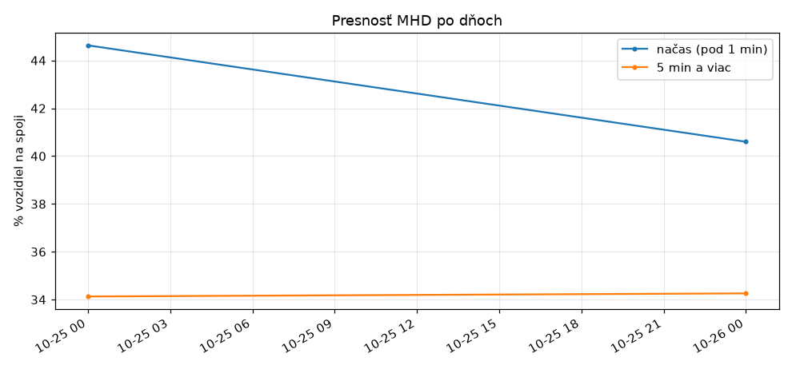
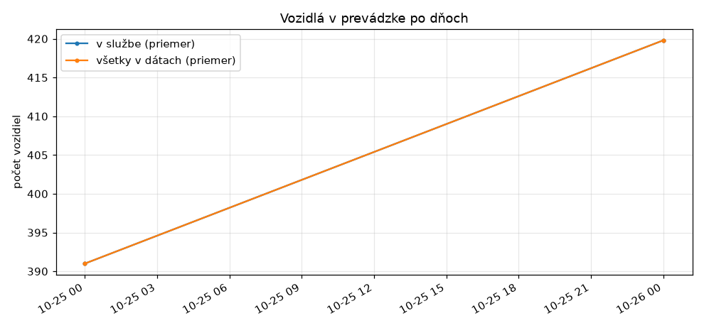
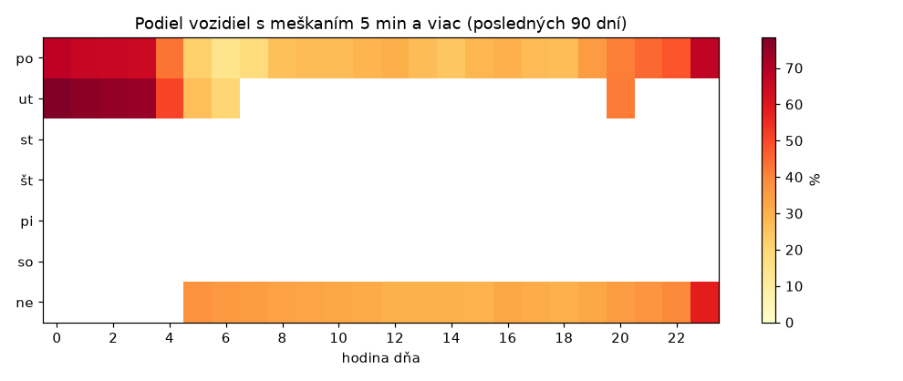
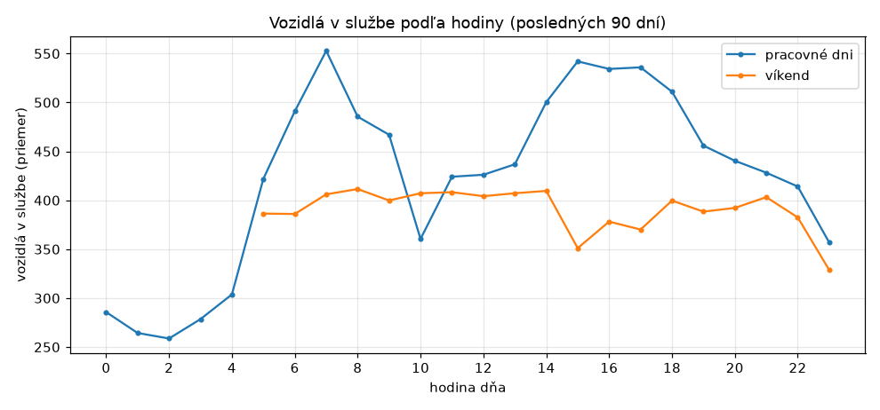
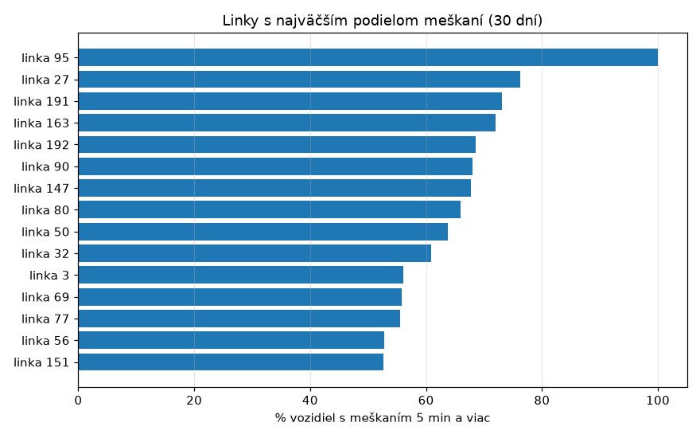
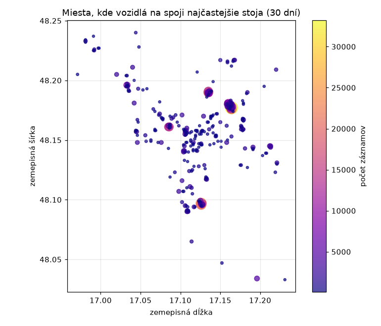

# Štatistiky MHD Bratislava

Automaticky generované 2026-11-16 23:10. Zdroj: kdejemhd.sk, zber každú minútu.

- Dní v štatistike: **3** (2026-10-25 až 2026-10-27)
- Priemerné pokrytie zberom: **65 %** (100 % = zber každú minútu celý deň)

## Vývoj v čase

## Kedy meškajú najviac

## Linky s najväčším podielom meškaní (30 dní)

| Linka | Meraní | Načas % | 5 min+ % | Priem. meškanie (min) |
|---|---|---|---|---|
| 95 | 2700 | 0.0 | 100.0 | 15.0 |
| 27 | 1266 | 13.0 | 76.2 | 10.1 |
| 191 | 8814 | 18.6 | 73.1 | 11.0 |
| 163 | 1004 | 10.9 | 72.0 | 10.5 |
| 192 | 4119 | 21.2 | 68.6 | 10.4 |
| 90 | 7413 | 19.5 | 67.9 | 10.3 |
| 147 | 2630 | 16.6 | 67.7 | 10.4 |
| 80 | 18571 | 24.3 | 66.0 | 9.9 |
| 50 | 34873 | 22.7 | 63.8 | 9.3 |
| 32 | 16276 | 23.3 | 60.8 | 8.7 |

## Podľa typu vozidla (30 dní)

| Typ | Meraní | Načas % | 5 min+ % |
|---|---|---|---|
| Autobusy | 687448 | 39.9 | 39.2 |
| Tramvaje | 234398 | 39.2 | 38.1 |
| Trolejbusy | 189101 | 48.6 | 27.5 |

## Miesta, kde vozidlá stoja

Zahŕňa aj konečné a zastávky, kde vozidlá stoja prirodzene.

## Dáta na stiahnutie

Denné agregáty vo formáte CSV (zostávajú v repozitári natrvalo):

- [daily.csv](data/daily.csv) celkové údaje po dňoch
- [daily_route.csv](data/daily_route.csv) po linkách
- [daily_hour.csv](data/daily_hour.csv) po hodinách
- [daily_type.csv](data/daily_type.csv) po type vozidla
- [daily_hotspots.csv](data/daily_hotspots.csv) miesta, kde vozidlá stoja

## Poznámky k metodike

- Meškanie zdroj udáva v celých minútach. Hodnota 15:00 vyzerá ako strop, takže priemerné meškanie je orezané a presnejšie sú podiely. Stĺpec `pct_cap15` v CSV ukazuje podiel hodnôt na strope.
- „Načas“ je meškanie pod 1 minútu, „5 min a viac“ zodpovedá kategórii „nad 5 min“ na webe.
- Do štatistík meškaní sa počítajú len vozidlá, ktoré majú údaj o meškaní (sú na spoji).
- Dni sa počítajú v čase Europe/Bratislava. Pokrytie pod 100 % znamená výpadky zberu.
- Nezávislý projekt, nie je súčasťou Dopravného podniku Bratislava.
