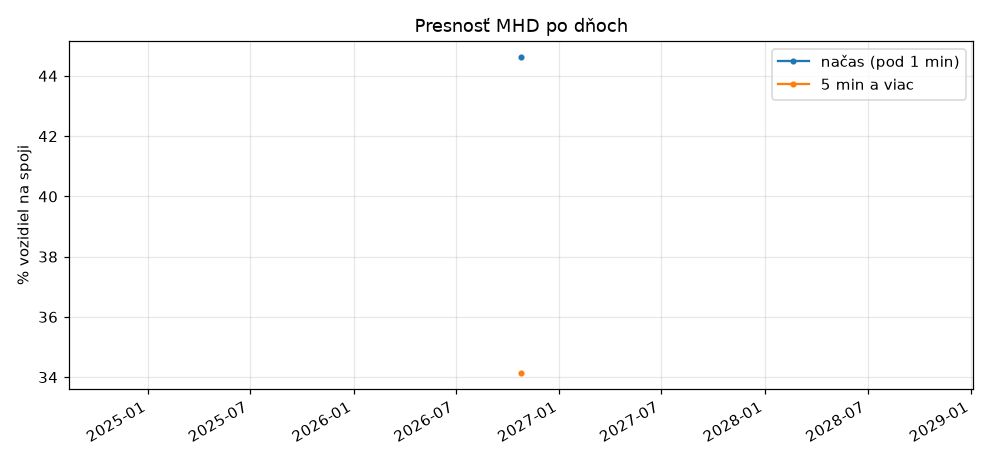
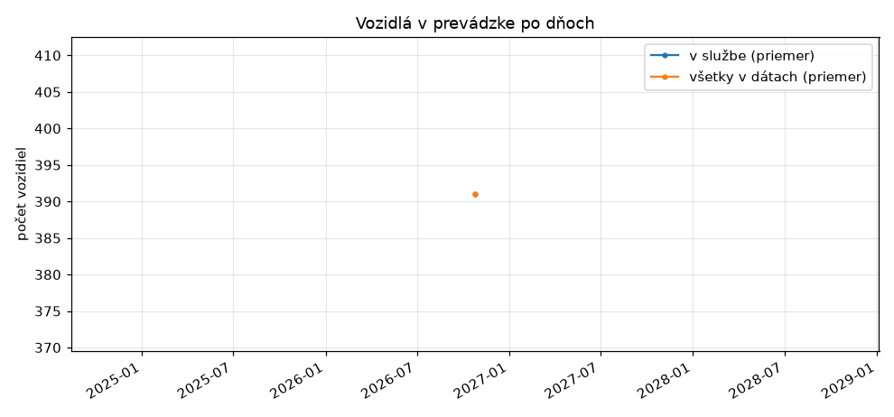
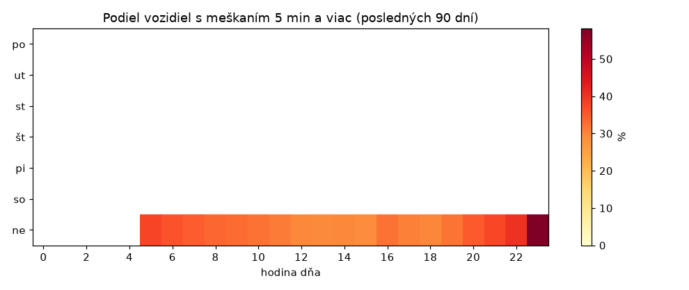
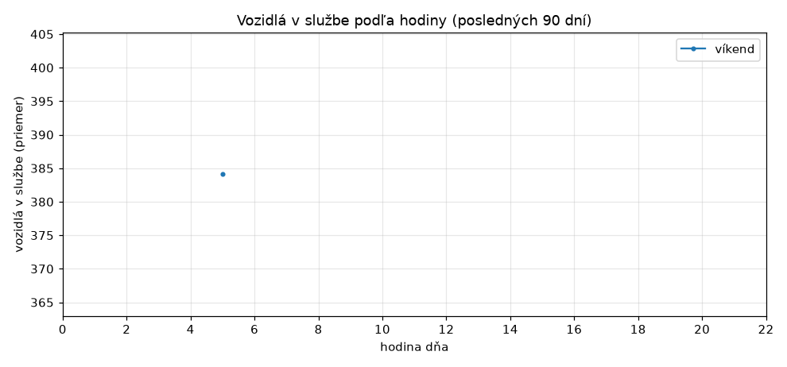
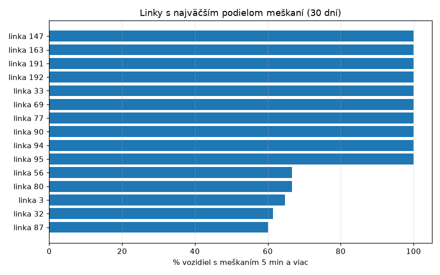
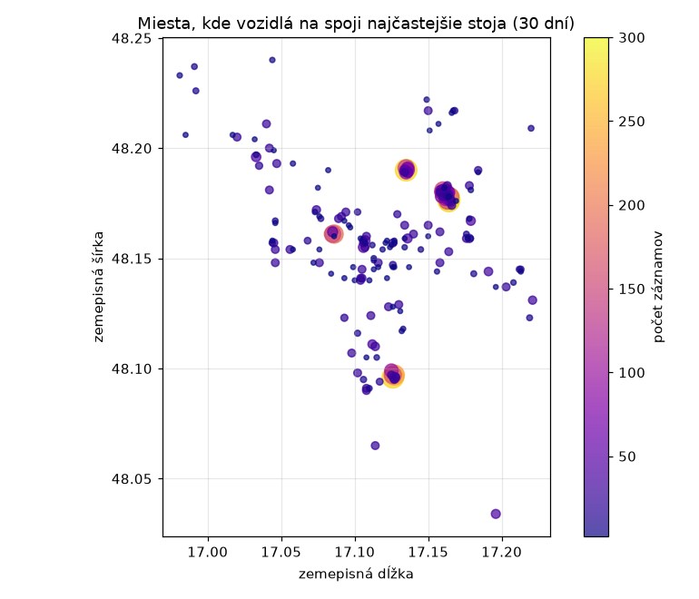

# Štatistiky MHD Bratislava

Automaticky generované 2026-10-26 07:10. Zdroj: kdejemhd.sk, zber každú minútu.

- Dní v štatistike: **1** (2026-10-25 až 2026-10-25)
- Priemerné pokrytie zberom: **73 %** (100 % = zber každú minútu celý deň)
- Posledných 7 dní: načas 44.6 %, meškanie 5 min a viac 34.1 %, v službe priemerne 391 vozidiel (408 948 meraní).

## Vývoj v čase

## Kedy meškajú najviac

## Linky s najväčším podielom meškaní (30 dní)

| Linka | Meraní | Načas % | 5 min+ % | Priem. meškanie (min) |
|---|---|---|---|---|
| 147 | 1005 | 0.0 | 100.0 | 15.0 |
| 191 | 2010 | 0.0 | 100.0 | 15.0 |
| 192 | 1005 | 0.0 | 100.0 | 15.0 |
| 94 | 1005 | 0.0 | 100.0 | 15.0 |
| 95 | 1005 | 0.0 | 100.0 | 15.0 |
| 90 | 3153 | 23.5 | 68.5 | 10.4 |
| 80 | 6645 | 26.9 | 64.7 | 9.6 |
| 77 | 1965 | 37.6 | 61.5 | 9.2 |
| 69 | 1829 | 18.3 | 60.6 | 9.1 |
| 50 | 12735 | 25.5 | 60.0 | 9.1 |

## Podľa typu vozidla (30 dní)

| Typ | Meraní | Načas % | 5 min+ % |
|---|---|---|---|
| Autobusy | 254324 | 43.1 | 37.1 |
| Tramvaje | 85347 | 41.5 | 35.3 |
| Trolejbusy | 69277 | 54.0 | 21.7 |

## Miesta, kde vozidlá stoja

Zahŕňa aj konečné a zastávky, kde vozidlá stoja prirodzene.

## Dáta na stiahnutie

Denné agregáty vo formáte CSV (zostávajú v repozitári natrvalo):

- [daily.csv](data/daily.csv) celkové údaje po dňoch
- [daily_route.csv](data/daily_route.csv) po linkách
- [daily_hour.csv](data/daily_hour.csv) po hodinách
- [daily_type.csv](data/daily_type.csv) po type vozidla
- [daily_hotspots.csv](data/daily_hotspots.csv) miesta, kde vozidlá stoja

## Poznámky k metodike

- Meškanie zdroj udáva v celých minútach. Hodnota 15:00 vyzerá ako strop, takže priemerné meškanie je orezané a presnejšie sú podiely. Stĺpec `pct_cap15` v CSV ukazuje podiel hodnôt na strope.
- „Načas“ je meškanie pod 1 minútu, „5 min a viac“ zodpovedá kategórii „nad 5 min“ na webe.
- Do štatistík meškaní sa počítajú len vozidlá, ktoré majú údaj o meškaní (sú na spoji).
- Dni sa počítajú v čase Europe/Bratislava. Pokrytie pod 100 % znamená výpadky zberu.
- Nezávislý projekt, nie je súčasťou Dopravného podniku Bratislava.
